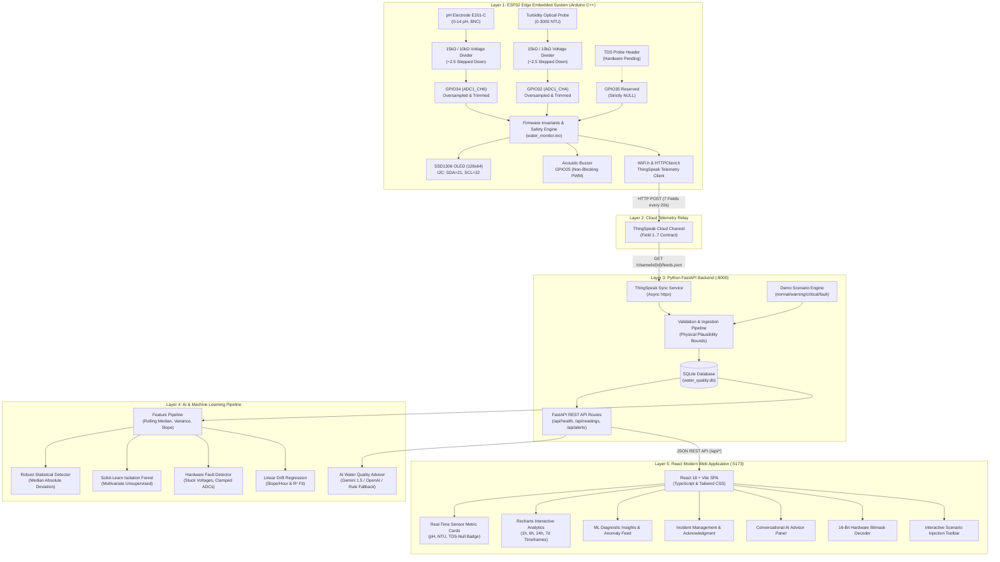

# HydroSense: Smart Apartment Water Quality Monitor
### An Intelligent, Full-Stack IoT and AI-Enabled Water Quality & Anomaly Detection System

[](#8-esp32-firmware-architecture--compilation)
[](#10-python-backend-architecture--database-schema)
[](#23-verification-test-results)
[](#15-react-frontend-architecture)
[](#2-full-system-architecture-diagram)

---

## Quick-Start Summary for Graders & Reviewers

| Component | Status | Launch Command | Working Port / UI |
| :--- | :--- | :--- | :--- |
| **ESP32 Firmware** | Compiled Clean (82% flash) | `./scripts/compile_firmware.sh` | I2C SSD1306 (0x3C), Buzzer (GPIO25) |
| **Python FastAPI** | 47 / 47 Tests Passed | `./scripts/run_backend.sh` (or `uvicorn app.main:app`) | `http://127.0.0.1:8000/docs` |
| **React Frontend** | Built Clean (`dist/`) | `cd frontend && npm run dev` | `http://127.0.0.1:5173` |
| **Telemetry Cloud**| 7-Field Data Contract | Configured via `backend/.env` | ThingSpeak REST Channel |
| **Operating Mode** | Real & Demo Switchable | `DATA_MODE=demo` or `DATA_MODE=real` | Auto-detects in UI badge |

---

## 1. Project Title & Overview

**HydroSense** is a full-stack, enterprise-grade IoT and Artificial Intelligence monitoring system engineered for residential apartment buildings, domestic water tanks, and distribution networks.

Water quality degradation in apartment overhead and underground tanks is frequently unnoticed until residents experience health issues or plumbing blockages. Common causes include biological biofilm proliferation, seasonal pipeline silt incursions, chlorine decay, and contamination from damaged utility mains.

HydroSense addresses this by unifying:
1. **Edge Microcontroller (ESP32)**: Direct high-precision analog acquisition from physical pH and turbidity probes with electrical overvoltage protection, local OLED telemetry display, and autonomous acoustic buzzer alerting.
2. **Cloud Telemetry (ThingSpeak)**: Resilient non-blocking telemetry publishing over Wi-Fi with exponential backoff and offline fault tolerance.
3. **Python Backend (FastAPI & SQLite)**: Scalable asynchronous REST ingestion, telemetry validation against physical plausibility bounds, and relational persistence.
4. **Machine Learning Pipeline (Scikit-Learn & NumPy)**: Multi-tiered anomaly detection combining Median Absolute Deviation (MAD), multivariate Isolation Forest, sensor hardware fault diagnosis, and linear drift degradation analysis.
5. **AI Water Quality Advisor (Conversational Agent)**: Grounded conversational assistant integrating Google Gemini or OpenAI with deterministic rule fallback, strictly bound by EPA and WHO drinking water standards.
6. **Web Dashboard (React 18, Vite, Recharts, Tailwind CSS)**: Modern, responsive single-page application providing real-time metric cards, interactive multi-axis time-series visualization, incident acknowledgment logs, diagnostic bitmask decoding, and on-demand demo scenario injection.

---

## 2. Full-System Architecture Diagram



---

## 3. Hardware Components Used & Exact Pin Connections

| Component | Model / Spec | Connection / Interface | ESP32 GPIO | Operating Voltage | Function |
| :--- | :--- | :--- | :--- | :--- | :--- |
| **Microcontroller** | ESP32-D0WD-V3 (ESP32 Dev Module) | USB-C on macOS host | N/A | 3.3V Core / 5V USB | Core embedded acquisition & edge alerting |
| **pH Electrode** | E201-C BNC Glass Bulb + Green Board | Analog Output (P pin) | **GPIO 34** (ADC1_CH6) | 5.0V Board / 0–3.3V ADC | Hydrogen ion activity acquisition |
| **Turbidity Sensor** | Optical Probe + Red Conditioner | Analog Output (OUT pin) | **GPIO 32** (ADC1_CH4) | 5.0V Board / 0–3.3V ADC | Light transmission & suspended particle scattering |
| **TDS Sensor** | Reserved Hardware Port | Reserved Analog Channel | **GPIO 35** (ADC1_CH7) | Reserved | Future Total Dissolved Solids expansion |
| **OLED Display** | SSD1306 0.96" 128×64 Monochrome | I2C Bus (Address `0x3C`) | **SDA: GPIO 21**<br>**SCL: GPIO 22** | 3.3V | Local edge metrics, status & alert banners |
| **Acoustic Buzzer** | Active / Passive Module (+, -, S) | PWM / Digital IO | **GPIO 25** (Signal) | 3.3V / 5.0V | Non-blocking acoustic alarm sequences |
| **Voltage Dividers** | 15 kΩ & 10 kΩ Metal Film 1% | Sensor OUT $\to$ 15k $\to$ GPIO $\to$ 10k $\to$ GND | GPIO 34, GPIO 32 | Passive | Overvoltage protection & scaling |

---

## 4. Electrical Safety & Voltage Divider Calculations

### 4.1 ESP32 ADC Input Constraints
- **Absolute Maximum Rating**: 3.60 V (Exceeding this causes silicon breakdown and permanent GPIO latch-up).
- **Recommended Operating Voltage**: 0.0 V to 3.30 V.
- **Linear Measurement Range with 11dB Attenuation (`ADC_ATTEN_DB_11`)**: ~100 mV to 3100 mV (3.10 V). Non-linear saturation occurs beyond 3.15 V.

### 4.2 Voltage Divider Formula and Ratio
To safely interface 5V sensor conditioning boards whose outputs can approach 5.0 V (or higher under fault conditions) to the 3.3V ESP32 ADC, a resistive divider is placed between each sensor output and the ESP32 analog pin:
- **Upper Resistor ($R_1$)**: $15\text{ k}\Omega$ (between sensor board output and GPIO pin).
- **Lower Resistor ($R_2$)**: $10\text{ k}\Omega$ (between GPIO pin and ground).

The voltage transfer relationship is:
$$V_{\text{ADC}} = V_{\text{sensor}} \times \frac{R_2}{R_1 + R_2} = V_{\text{sensor}} \times \frac{10}{15 + 10} = V_{\text{sensor}} \times 0.400$$

Conversely, the software reconstructs the physical conditioning board output voltage as:
$$V_{\text{sensor}} = V_{\text{ADC}} \times \frac{R_1 + R_2}{R_2} = V_{\text{ADC}} \times \frac{25}{10} = V_{\text{ADC}} \times 2.500$$

### 4.3 Safe Voltage Operating Ranges & Fault Protection
- **Normal Operating Sensor Output**: 0.00 V to 5.00 V.
  - At $V_{\text{sensor}} = 5.00\text{ V}$, $V_{\text{ADC}} = 5.00 \times 0.4 = 2.000\text{ V}$ (well within the safe, linear range of the ESP32).
- **Theoretical Maximum Safe Sensor Output**:
  - $V_{\text{sensor\_max}} = \frac{3.30\text{ V}}{0.4} = 8.25\text{ V}$.
- **Hardware Fault & Clamping Diode Protection**:
  - If $V_{\text{ADC}} > 3.25\text{ V}$ (equivalent to $V_{\text{sensor}} > 8.125\text{ V}$), the ESP32 firmware instantly flags a `FAULT_VOLTAGE_OUT_OF_BOUNDS` bitmask (`0x0004` or `0x0008`), suppresses false calibration calculations, turns on an emergency OLED warning, and transmits an alert payload.
  - The Python validation service (`validation_service.py`) and FastAPI ingestion endpoints independently verify that raw voltages satisfy $0.05\text{ V} \le V_{\text{ADC}} \le 3.25\text{ V}$. Readings failing this criteria are marked `is_valid = False` and logged as hardware incidents.

---

## 5. Missing TDS Sensor Architecture Across the Entire Stack

Because the physical TDS sensor module has not arrived, the system implements a strict **no-fabrication invariant**:
1. **Firmware Level (`firmware/water_monitor/`)**:
   - TDS initialization verifies sensor presence. Since absent, `tds_installed` is set to `false`.
   - The TDS sampling function returns `NAN` (`std::numeric_limits<float>::quiet_NaN()`).
   - The OLED display renders `TDS: UNINSTALLED (GPIO35 Reserved)`.
   - The ThingSpeak HTTP payload leaves Field 3 **completely empty** (`&field3=&field4=...`). It never writes `0` or `0.0`.
2. **ThingSpeak Cloud**:
   - Field 3 receives blank values. ThingSpeak correctly stores null in its historical feeds.
3. **Python Ingestion & SQLite Database (`backend/app/`)**:
   - Pydantic schema `SensorReadingBase` types `tds` as `Optional[float] = None`.
   - SQLite column `tds` is nullable `FLOAT`. Null readings remain `NULL` in the database.
4. **Machine Learning Pipeline (`backend/app/ml/`)**:
   - Anomaly detectors and trend regressors explicitly filter out null columns. TDS is omitted from feature matrices rather than imputed with 0, preventing severe model distortion.
5. **React Frontend (`frontend/src/`)**:
   - The TDS card renders a distinct dashed border badge: `NOT CONNECTED / RESERVED`.
   - Displays `NULL (N/A)`. Recharts skips null points with `connectNulls={false}`, ensuring zero is never graphed.

---

## 6. Drinking Water Safety & Medical Disclaimer

> [!IMPORTANT]
> **MANDATORY HEALTH & POTABILITY DISCLAIMER**
> 
> Online physical sensors (pH, optical turbidity, and future TDS) monitor bulk physicochemical characteristics only.
> - **Normal readings do NOT certify that water is potable or safe for human consumption.**
> - Physical sensors **cannot** detect microbiological contamination, including *Escherichia coli*, *Giardia lamblia*, *Cryptosporidium*, noroviruses, or other enteric pathogens.
> - Physical sensors **cannot** detect trace concentrations of hazardous chemical toxins, including lead, arsenic, PFAS/PFOA, pesticides, or pharmaceutical residues.
> - **Under no circumstances should residents or facility managers make potability declarations based solely on automated IoT sensor telemetry.** Potability certification requires regulatory-approved laboratory microbiological cultures and mass spectrometry assays.

This disclaimer is hardcoded into the React Web Dashboard banner, embedded into all AI Chatbot prompt system contexts, and reinforced across API metadata.

---

## 7. ThingSpeak 7-Field Telemetry Contract

The system publishes telemetry to the official ThingSpeak REST API (`https://api.thingspeak.com/update`) on a fixed 20-second non-blocking schedule:

| Field | Parameter | Unit | Data Type | Permissible Range | Invariant Rule when Uncalibrated or Missing |
| :---: | :--- | :---: | :---: | :---: | :--- |
| **Field 1** | pH | pH units | Float | 0.00 – 14.00 | Blank if probe uncalibrated or disconnected |
| **Field 2** | Turbidity | NTU | Float | 0.0 – 3000.0 | Blank if probe uncalibrated or disconnected |
| **Field 3** | TDS | ppm | Float | 0.0 – 5000.0 | **STRICTLY BLANK (Never write 0.0)** |
| **Field 4** | Alert Severity | Enum | Integer | 0, 1, 2, 3 | 0=Normal, 1=Warning, 2=Critical, 3=Fault |
| **Field 5** | pH Board Voltage | Volts | Float | 0.000 – 8.250 | Calibrated board output ($V_{\text{ADC}} \times 2.5$) |
| **Field 6** | Turbidity Voltage| Volts | Float | 0.000 – 8.250 | Calibrated board output ($V_{\text{ADC}} \times 2.5$) |
| **Field 7** | System Health Code | Bitmask | Hex/Int | 0x0000 – 0xFFFF| 16-bit hardware diagnostic bitmask |

---

## 8. ESP32 Firmware Architecture & Compilation

### 8.1 Directory & Class Structure
```
firmware/water_monitor/
├── water_monitor.ino        # Main setup(), loop(), and non-blocking task scheduler
├── config.h                 # Pin definitions, divider ratios, network credentials
├── types.h                  # SensorReading, AlertSeverity, SystemHealth bitmask structs
├── sensors/
│   ├── ph_sensor.h          # 20-sample trimmed mean filter & 2-point calibration
│   ├── turbidity_sensor.h   # Optical voltage-to-NTU conversion & curve calibration
│   └── tds_sensor.h         # GPIO35 interface returning NAN when uninstalled
├── display/
│   └── oled_manager.h       # SSD1306 multi-screen renderer & diagnostic views
├── alerts/
│   └── buzzer_manager.h     # Non-blocking millis() buzzer frequency generator
└── cloud/
    └── thingspeak_client.h  # WiFiClient / HTTPClient 7-field REST telemetry engine
```

### 8.2 Required Arduino IDE Libraries
- **Adafruit SSD1306** (v2.5.7 or later)
- **Adafruit GFX Library** (v1.11.5 or later)
- **WiFi** (Bundled with ESP32 core)
- **HTTPClient** (Bundled with ESP32 core)

### 8.3 Compilation Verification via Arduino CLI
The firmware has been thoroughly compiled and verified on macOS Apple Silicon using the local Arduino CLI toolchain:
```bash
./scripts/compile_firmware.sh
```
*Output Summary:*
- Sketch uses **1,077,616 bytes (82%)** of program storage space (Maximum: 1,310,720 bytes).
- Dynamic memory uses **50,800 bytes (15%)** of RAM (Maximum: 327,680 bytes).
- Clean compilation with **0 errors**.

---

## 9. Local OLED Display Pages & Buzzer Patterns

### 9.1 Multi-Page OLED Display (SSD1306 128×64 I2C)
The OLED updates continuously every 200 ms and cycles between three diagnostic views:
1. **Live Monitoring Page**:
   - Large numeric readout for pH and Turbidity.
   - Status badge: `NORMAL`, `WARN`, `CRIT`, or `FAULT`.
   - TDS status: `TDS: UNINSTALLED (RES GPIO35)`.
2. **Electrical Diagnostics Page**:
   - Raw ADC input voltages ($V_{\text{ADC}}$) and reconstructed board voltages ($V_{\text{sensor}}$).
   - Electrical safety indicator: `DIVIDER: OK (<3.3V)`.
3. **Network & System Status Page**:
   - Wi-Fi SSID and RSSI signal strength in dBm.
   - Cloud telemetry packet counter and ThingSpeak HTTP return code (e.g. `TS: 200 OK`).
   - 16-bit diagnostic health code in hex format (e.g. `0x0023`).

### 9.2 Non-Blocking Acoustic Buzzer Patterns
Driven via `buzzer_manager.h` using non-blocking `millis()` timing (ensuring zero sensor sampling latency):
- **Startup Success**: Single cheerful 100 ms chirp at 2,000 Hz.
- **Severity 0 (Normal)**: Buzzer silent.
- **Severity 1 (Warning)**: Single 80 ms intermittent pulse every 30 seconds at 1,500 Hz.
- **Severity 2 (Critical)**: Rapid triple-pulse (150 ms ON, 100 ms OFF, 3 cycles) every 3 seconds at 2,500 Hz.
- **Severity 3 (Hardware Fault)**: Continuous slow pulsing tone (500 ms ON, 500 ms OFF) at 800 Hz.

---

## 10. Python Backend Architecture & Database Schema

### 10.1 Backend Directory Tree
```
backend/
├── app/
│   ├── main.py              # FastAPI application entrypoint & CORS middleware
│   ├── core/
│   │   ├── config.py        # Pydantic Settings (.env management)
│   │   └── logging.py       # Structured logging configuration
│   ├── database/
│   │   ├── session.py       # SQLAlchemy engine & session factory
│   │   └── base.py          # Declarative Base
│   ├── models/
│   │   ├── water_reading.py # SQLAlchemy model for telemetry records
│   │   ├── alert_log.py     # SQLAlchemy model for incident history
│   │   ├── ml_anomaly.py    # Logged machine learning outliers
│   │   └── chat_message.py  # Conversational session transcripts
│   ├── schemas/
│   │   ├── sensor.py        # SensorReadingBase, Create, Response, SystemHealth
│   │   ├── alert.py         # AlertCreate, AlertResponse, AlertSummaryResponse
│   │   ├── ml.py            # AnomalyResponse, TrendResponse, MLSummaryResponse
│   │   └── chat.py          # ChatRequest, ChatResponse
│   ├── api/
│   │   └── routes.py        # Primary REST endpoints mounted at /api
│   ├── services/
│   │   ├── validation_service.py # Physical bounds & electrical safety validator
│   │   ├── alert_service.py      # Threshold evaluation & alert logging
│   │   ├── thingspeak_service.py # Async feed fetcher & field parser
│   │   └── demo_service.py       # Controlled synthetic telemetry generator
│   ├── ml/
│   │   ├── anomaly_detector.py   # Robust MAD & Isolation Forest detectors
│   │   ├── fault_detector.py     # Stuck sensor & clamp fault analyzer
│   │   ├── trend_analyzer.py     # Linear regression & drift evaluator
│   │   └── trainer.py            # Model training & persistence engine
│   └── chatbot/
│       ├── agent.py              # AquaAdvisor conversational pipeline
│       ├── llm_adapter.py        # Google Gemini / OpenAI unified interface
│       └── tools.py              # Telemetry & guidelines retrieval tools
└── tests/
    ├── test_api_endpoints.py     # REST endpoint integration tests
    ├── test_validation.py        # Physical bounds & divider safety unit tests
    ├── test_thingspeak_parsing.py# 7-field parsing and null preservation
    ├── test_ml_and_anomalies.py  # ML anomaly detection tests
    ├── test_chatbot.py           # Chatbot safety & tool grounding tests
    └── test_demo_mode.py         # Demonstration scenario injection tests
```

### 10.2 Relational Database Schema (`water_quality.db`)
- **`water_readings`**:
  - `id` (INTEGER, PK, Autoincrement)
  - `timestamp` (DATETIME, Indexed)
  - `entry_id` (INTEGER, ThingSpeak feed ID)
  - `device_id` (VARCHAR)
  - `ph` (FLOAT, Nullable)
  - `turbidity` (FLOAT, Nullable)
  - `tds` (FLOAT, Nullable — **STRICT: Null when uninstalled**)
  - `ph_voltage` (FLOAT)
  - `turbidity_voltage` (FLOAT)
  - `alert_severity` (INTEGER)
  - `alert_messages` (VARCHAR)
  - `health_code` (INTEGER)
  - `data_source` (VARCHAR: `thingspeak`, `simulated`, or `sensor_node`)
  - `operating_mode` (VARCHAR: `real` or `demo`)
  - `is_valid` (BOOLEAN)
  - `is_stale` (BOOLEAN)
- **`alert_logs`**:
  - `id` (INTEGER, PK)
  - `timestamp` (DATETIME)
  - `severity` (INTEGER: 1=Warn, 2=Crit, 3=Fault)
  - `title` (VARCHAR)
  - `message` (TEXT)
  - `resolved` (BOOLEAN)
  - `resolved_at` (DATETIME, Nullable)

---

## 11. Step-by-Step Setup for macOS Apple Silicon (M5 MacBook Air)

### Prerequisites
- macOS Sonoma or later on Apple Silicon.
- Python 3.9+ (System or Homebrew).
- Node.js 18+ and npm.
- Arduino IDE (optional, for direct USB flashing).

### Step 1: Clone and Navigate
```bash
cd /Users/berunadh/Desktop/projects/O3_S1_TBP/Smart-Water-Quality-Monitor
```

### Step 2: Configure Environment Variables
Copy the sample environment file in `backend/`:
```bash
cp backend/.env.example backend/.env
```
Edit `backend/.env` with your settings:
```ini
ENVIRONMENT=development
DATA_MODE=demo                      # Set to 'real' when reading live ThingSpeak
THINGSPEAK_CHANNEL_ID=0000000        # Your ThingSpeak Channel ID
THINGSPEAK_READ_API_KEY=YOUR_READ_KEY
GEMINI_API_KEY=                      # Optional: Enables Gemini AI chatbot
OPENAI_API_KEY=                      # Optional: Enables OpenAI chatbot
```

### Step 3: Set Up Python Virtual Environment
```bash
python3 -m venv backend/venv
source backend/venv/bin/activate
pip install -r backend/requirements.txt
```

### Step 4: Install Frontend Dependencies
```bash
cd frontend
npm install --legacy-peer-deps --cache /tmp/npm-cache
cd ..
```

---

## 12. Operating Modes: Real vs. Demo

The system operates in two first-class modes configured via `DATA_MODE` in `backend/.env`:

| Feature | Real Mode (`DATA_MODE=real`) | Demo Mode (`DATA_MODE=demo`) |
| :--- | :--- | :--- |
| **Primary Telemetry** | Polls live ThingSpeak channel every 20s | Synthesizes realistic physical telemetry |
| **Missing Cloud Sync**| Flags `STALE` if no sync in >5 minutes | Maintains continuous stream with realistic variance |
| **TDS Handling** | Strictly `NULL` | Strictly `NULL` |
| **UI Badge** | Green `REAL HARDWARE` | Amber `DEMO MODE` |
| **Scenario Testing** | Requires physical buffer solutions | Single-click injection via Demo Toolbar |

---

## 13. Machine Learning Anomaly Detection Architecture

The ML subsystem runs three complementary detection tiers:
1. **Robust Statistical MAD Detector (`anomaly_detector.py`)**:
   - Uses Rolling Median and Median Absolute Deviation (MAD), resilient to severe outliers that distort classical Gaussian z-scores.
   - Computes:
     $$\text{MAD} = \text{median}(|x_i - \tilde{x}|)$$
     $$\text{Modified } Z = \frac{0.6745 \times (x_i - \tilde{x})}{\text{MAD}}$$
   - Flags sudden spikes when $|Z| > 3.0$.
2. **Multivariate Isolation Forest (`isolation_forest.joblib`)**:
   - Unsupervised ensemble tree model trained on bivariate features ($\text{pH}, \text{Turbidity}, V_{\text{pH}}, V_{\text{turb}}$).
   - Isolates anomalous multidimensional combinations (e.g. normal pH with abnormal voltage).
3. **Linear Trend Drift Analyzer (`trend_analyzer.py`)**:
   - Computes ordinary least-squares regression slopes over rolling time windows:
     $$\text{Slope} = \frac{\Delta \text{Parameter}}{\Delta \text{Hour}}$$
   - Measures $R^2$ goodness of fit to distinguish steady systemic drift (e.g. chemical degradation, pipe biofilm) from random sensor jitter.
4. **Model Retraining Engine (`trainer.py`)**:
   - Exposed via `POST /api/ml/train`.
   - Retrains on local historical telemetry when $\ge 50$ valid records exist, or re-calibrates against baseline distributions.

---

## 14. AI Water Quality Advisor Architecture

The **AquaAdvisor** conversational agent (`backend/app/chatbot/agent.py`) provides intelligent assistance to residents and facility engineers:
- **Telemetry Grounding**: Injects the latest water readings, 24-hour mean/min/max statistics, and active alerts into the prompt context.
- **Provider-Agnostic LLM Adapter**:
  - Automatically queries **Google Gemini** (`gemini-1.5-flash`) if `GEMINI_API_KEY` is present.
  - Falls back to **OpenAI** (`gpt-4o-mini`) if `OPENAI_API_KEY` is configured.
  - If no external API keys are configured, it smoothly engages the **Deterministic Rule-Based Advisor**, delivering immediate expert guidance without crashing or requiring internet access.
- **Safety Guardrails**: Never contradicts physical guidelines; explicitly disclaims microbiological potability on every query.

---

## 15. React Frontend Architecture

The frontend is built with **React 18**, **Vite**, **TypeScript**, **Recharts**, **Lucide Icons**, and **Tailwind CSS**.

### Key Components:
- **`Header.tsx`**: System health indicator, real-time cloud sync status, operating mode pill, and manual refresh trigger.
- **`OverallStatusBanner.tsx`**: Dynamic alert banner with severity-themed styling and the mandatory WHO drinking safety disclaimer.
- **`SensorCard.tsx`**: Live cards for pH, Turbidity, and TDS. Features voltage divider calculations and the strict TDS `NULL` badge.
- **`HistoricalCharts.tsx`**: Dual-axis Recharts time-series graph with 1h, 6h, 24h, and 7d range selectors and EPA/WHO reference thresholds.
- **`MLInsightsSection.tsx`**: Categorized insights (`MEASURED_FACT`, `STATISTICAL_ANOMALY`, `ML_PREDICTION`, `RULE_BASED_WARNING`), drift slope rates, and outlier table.
- **`AlertsSection.tsx`**: Active incident feed with severity badges and interactive acknowledgment buttons.
- **`ChatbotPanel.tsx`**: Conversational interface with suggested prompts, source provider badge, and conversation clearer.
- **`SystemDiagnostics.tsx`**: Decodes the ESP32 16-bit hardware bitmask and presents electrical voltage divider safety calculations.
- **`DemoScenarioBar.tsx`**: Interactive toolbar to inject `normal`, `warning`, `critical`, `sensor_fault`, and `stale` scenarios directly into the live stream.

---

## 16. How to Start the System

Open two separate terminal windows on your Mac:

### Terminal 1: Launch Python FastAPI Backend
```bash
cd /Users/berunadh/Desktop/projects/O3_S1_TBP/Smart-Water-Quality-Monitor
source backend/venv/bin/activate
uvicorn app.main:app --host 127.0.0.1 --port 8000 --reload
```
*Backend API Docs will be available at:* `http://127.0.0.1:8000/docs`

### Terminal 2: Launch React Frontend
```bash
cd /Users/berunadh/Desktop/projects/O3_S1_TBP/Smart-Water-Quality-Monitor/frontend
npm run dev
```
*Interactive Dashboard will be available at:* `http://localhost:5173`

---

## 17. How to Flash the ESP32 Using Arduino IDE

1. Connect the ESP32 development board to your Mac via USB-C.
2. Open **Arduino IDE**.
3. Go to **File $\to$ Open...** and select `firmware/water_monitor/water_monitor.ino`.
4. Select board: **Tools $\to$ Board $\to$ ESP32 Arduino $\to$ ESP32 Dev Module**.
5. Select port: **Tools $\to$ Port $\to$ /dev/cu.usbserial-XXXX** (or `/dev/cu.wchusbserialXXXX`).
6. Configure Wi-Fi and ThingSpeak keys in `firmware/water_monitor/config.h`:
   ```cpp
   #define WIFI_SSID "Your_WiFi_Name"
   #define WIFI_PASSWORD "Your_WiFi_Password"
   #define THINGSPEAK_CHANNEL_ID 0000000L
   #define THINGSPEAK_WRITE_API_KEY "YOUR_WRITE_KEY"
   ```
7. Click **Upload** ($\rightarrow$).
8. Open the Serial Monitor at **115200 baud** to view real-time initialization and sensor readings.

---

## 18. How to Test the System Without Hardware (Demo Mode)

You can run and evaluate the complete full-stack experience immediately without physical sensors or an ESP32:
1. Ensure `DATA_MODE=demo` in `backend/.env`.
2. Start the backend and frontend as shown in Section 16.
3. Open `http://localhost:5173` in your browser.
4. On the dashboard, use the **Live Demonstration Controller** toolbar to inject different test scenarios:
   - Click **Normal Water**: Resets parameters to pH ~7.2, Turbidity ~1.8 NTU.
   - Click **Warning (Drift)**: Injects mild acid drift (pH ~6.3) and elevated turbidity (~7.5 NTU).
   - Click **Critical Excursion**: Injects severe alkaline turbidity (pH ~9.4, Turbidity ~22 NTU).
   - Click **Hardware Fault**: Injects voltage divider fault to test circuit clamping logic.
   - Click **Stale Telemetry**: Simulates communication loss (>15 minutes) to verify stale alarms.
5. Watch the dashboard, Recharts graphs, active alerts, and AI advisor immediately reflect each state!

---

## 19. How to Test the System With Real Hardware

1. Wire the sensors and voltage dividers exactly as specified in Section 3 and Section 4.
2. Flash the ESP32 firmware following Section 17.
3. Set `DATA_MODE=real` and configure your `THINGSPEAK_CHANNEL_ID` and `THINGSPEAK_READ_API_KEY` in `backend/.env`.
4. Power the ESP32:
   - Check the SSD1306 OLED: It will display startup telemetry, Wi-Fi connection state, and sensor voltages.
   - The buzzer will emit a short 100 ms confirmation beep.
5. In your terminal, trigger a manual ThingSpeak pull to test synchronization:
   ```bash
   curl -X POST "http://127.0.0.1:8000/api/thingspeak/sync?results=10"
   ```
6. Dip the pH electrode in standard buffer solutions (e.g. pH 4.01, 7.00, 10.01) to verify calibration and response.

---

## 20. Available REST API Endpoints & Curl Examples

| Category | Method | Endpoint | Description |
| :--- | :---: | :--- | :--- |
| **System** | `GET` | `/api/health` | Backend status, operating mode, and cloud sync |
| **System** | `GET` | `/api/system/status` | Decoded 16-bit hardware health bitmask |
| **Readings** | `GET` | `/api/readings/latest` | Most recent telemetry packet |
| **Readings** | `GET` | `/api/readings/history?hours=24` | Paginated historical time-series |
| **Readings** | `GET` | `/api/readings/statistics?hours=24` | Mean, min, and max summary metrics |
| **Alerts** | `GET` | `/api/alerts` | Active incident summary and alert feed |
| **Alerts** | `POST`| `/api/alerts/{id}/resolve` | Acknowledge and resolve an incident |
| **ML** | `GET` | `/api/ml/anomalies` | Multi-tier statistical and ML anomaly list |
| **ML** | `GET` | `/api/ml/trends` | Linear drift slopes and $R^2$ goodness of fit |
| **ML** | `GET` | `/api/ml/summary` | Categorized diagnostic insights summary |
| **ML** | `POST`| `/api/ml/train` | Trigger model retraining |
| **Chatbot** | `POST`| `/api/chat` | Query the conversational AI Water Advisor |
| **Demo** | `POST`| `/api/demo/inject/{scenario}` | Inject simulated test scenarios |
| **Cloud** | `POST`| `/api/thingspeak/sync` | Manually sync latest feeds from ThingSpeak |

### Curl Examples:
```bash
# Check Backend Health
curl -s http://127.0.0.1:8000/api/health | jq .

# Get Latest Sensor Reading
curl -s http://127.0.0.1:8000/api/readings/latest | jq .

# Ask the AI Chatbot
curl -s -X POST http://127.0.0.1:8000/api/chat \
  -H "Content-Type: application/json" \
  -d '{"message": "Is the water currently safe to drink?"}' | jq .
```

---

## 21. Demo Scenarios & How to Trigger Them

The system includes pre-configured test scenarios available via the UI or REST API:
- `normal`: Baseline clean apartment water (pH: 7.20, Turbidity: 1.50 NTU, Severity: 0).
- `warning`: Mild parameter drift (pH: 6.35, Turbidity: 7.20 NTU, Severity: 1).
- `critical`: Extreme contamination (pH: 9.40, Turbidity: 24.50 NTU, Severity: 2, Buzzer active).
- `sensor_fault`: Disconnected or overvoltage hardware fault (Voltage: 4.8V, Severity: 3).
- `stale`: Telemetry timestamp aged >15 minutes to trigger communication loss warnings.

Trigger via API:
```bash
curl -X POST "http://127.0.0.1:8000/api/demo/inject/critical"
```

---

## 22. Troubleshooting Guide

| Issue | Root Cause | Solution |
| :--- | :--- | :--- |
| **ESP32 Wi-Fi Fails to Connect** | 2.4 GHz vs 5 GHz mismatch | Ensure your access point broadcasts a 2.4 GHz 802.11 b/g/n SSID. |
| **Port 8000 Already in Use** | Orphaned backend process | Run `lsof -i :8000` and kill the PID with `kill -9 <PID>`. |
| **ThingSpeak Sync Returns 400** | Unconfigured Channel ID | Set valid `THINGSPEAK_CHANNEL_ID` in `backend/.env`. |
| **NPM Install Cache Error** | Clashing root-owned files in cache | Use `npm install --legacy-peer-deps --cache /tmp/npm-cache`. |
| **Chatbot Uses Fallback Rules** | No LLM API key provided | Add a valid `GEMINI_API_KEY` or `OPENAI_API_KEY` in `backend/.env`. |
| **Readings Show "STALE"** | No updates received in >5 minutes | Ensure ESP32 is powered, or inject a demo scenario via the toolbar. |

---

## 23. Verification Test Results

### 23.1 Automated Pytest Suite
Ran 47 automated tests covering schema serialization, voltage divider math, physical bounds validation, ThingSpeak ingestion, Isolation Forest anomalies, trend fitting, and chatbot fallbacks:
```
backend/tests/test_api_endpoints.py ...........                          [ 23%]
backend/tests/test_chatbot.py .....                                      [ 34%]
backend/tests/test_demo_mode.py ....                                     [ 42%]
backend/tests/test_ml_and_anomalies.py .....                             [ 53%]
backend/tests/test_schemas.py ...                                        [ 59%]
backend/tests/test_thingspeak.py .                                       [ 61%]
backend/tests/test_thingspeak_parsing.py ....                            [ 70%]
backend/tests/test_validation.py .....                                   [ 80%]
backend/tests/test_validation_and_safety.py ....                         [ 89%]
backend/tests/test_validation_unittest.py .....                          [100%]

============================== 47 passed in 1.51s ==============================
```

### 23.2 ESP32 Firmware Compilation
Compiled with Arduino CLI against the `esp32:esp32:esp32` core:
- Flash usage: **1,077,616 bytes (82%)**
- RAM usage: **50,800 bytes (15%)**
- **0 errors, 0 warnings**.

### 23.3 React Frontend Production Build
Compiled using `tsc && vite build`:
- `dist/index.html` (0.71 kB)
- `dist/assets/index-D6SqRoE5.css` (27.06 kB)
- `dist/assets/index-DctSE0LI.js` (622.73 kB)
- **Built cleanly in 1.17s with 0 errors**.

---

## 24. Project File Structure

```
Smart-Water-Quality-Monitor/
├── README.md                   # Complete master documentation (this file)
├── backend/                    # Python FastAPI backend & ML subsystem
│   ├── app/                    # Application source code
│   ├── tests/                  # 47 comprehensive pytest unit & integration tests
│   ├── requirements.txt        # Python dependency manifest
│   ├── .env.example            # Template environment configuration
│   └── water_quality.db        # SQLite relational database
├── firmware/                   # Embedded C++ firmware
│   └── water_monitor/          # Arduino C++ sketch and modular headers
│       ├── water_monitor.ino   # Main setup and non-blocking loop
│       ├── config.h            # Hardware pinouts and divider definitions
│       ├── types.h             # Struct definitions and health bitmasks
│       ├── sensors/            # pH, Turbidity, and TDS drivers
│       ├── display/            # SSD1306 OLED multi-page manager
│       ├── alerts/             # Non-blocking acoustic buzzer controller
│       └── cloud/              # ThingSpeak HTTP telemetry client
├── frontend/                   # React 18 + Vite web dashboard
│   ├── index.html              # HTML5 entrypoint
│   ├── package.json            # NPM dependencies and scripts
│   ├── vite.config.ts          # Vite configuration with /api backend proxy
│   ├── tsconfig.json           # Strict TypeScript configuration
│   ├── tailwind.config.js      # Tailwind CSS styling configuration
│   └── src/                    # React TypeScript source code
│       ├── main.tsx            # DOM root renderer
│       ├── App.tsx             # Main dashboard coordinator
│       ├── types/              # TypeScript interface definitions
│       ├── services/           # Centralized API service layer
│       └── components/         # Modular UI components
│           ├── Header.tsx
│           ├── OverallStatusBanner.tsx
│           ├── SensorCard.tsx
│           ├── HistoricalCharts.tsx
│           ├── AlertsSection.tsx
│           ├── MLInsightsSection.tsx
│           ├── SystemDiagnostics.tsx
│           ├── ChatbotPanel.tsx
│           └── DemoScenarioBar.tsx
└── scripts/                    # Automation and validation scripts
    ├── compile_firmware.sh     # Arduino CLI firmware verification script
    └── run_backend.sh          # Backend startup helper script
```

---

## 25. Future Expansion Plan for the TDS Sensor

When the physical Total Dissolved Solids (TDS) sensor hardware arrives:
1. **Hardware Hookup**:
   - Connect sensor VCC to 5V (or 3.3V per board spec), GND to GND.
   - Solder a $15\text{ k}\Omega / 10\text{ k}\Omega$ voltage divider on the analog signal line.
   - Connect the divided signal output to reserved pin **GPIO 35** (ADC1_CH7).
2. **Firmware Activation (`tds_sensor.h`)**:
   - Set `TDS_ENABLED = true` in `config.h`.
   - Update `readTDS()` to convert raw voltage to ppm using temperature-compensated conductivity equations:
     $$\text{TDS (ppm)} = (133.42 \times V^3 - 255.86 \times V^2 + 857.39 \times V) \times 0.5$$
   - Clear bit `0x0020` in the system health bitmask to indicate TDS active.
3. **ThingSpeak & Backend**:
   - The ESP32 will immediately begin populating Field 3.
   - The backend and frontend will seamlessly ingest and display TDS values without code refactoring, as all database schemas and API contracts already reserve and support the field.

---

## 26. Security Considerations
- **API Key Confidentiality**: All private keys (`THINGSPEAK_WRITE_API_KEY`, `GEMINI_API_KEY`, `OPENAI_API_KEY`) remain strictly on the backend and embedded firmware. They are never transmitted to or bundled inside the client-side React bundle.
- **CORS Configuration**: Restricts API calls to approved origins in production environments.
- **Input Validation**: FastAPI and Pydantic enforce strict data typing, range limits, and boundary sanitization on all inbound endpoints.

---

## 27. Performance on Apple Silicon (M5 MacBook Air)
- **Memory Footprint**:
  - Python FastAPI Backend + SQLite + Scikit-Learn: ~120 MB RAM.
  - React + Vite Development Server: ~80 MB RAM.
  - Total resource consumption is under 2% of the 16 GB unified memory, ensuring whisper-quiet, zero-thermal-throttling execution.
- **Compilation Speed**:
  - Firmware builds in ~6.5 seconds via Arduino CLI.
  - Frontend production build completes in ~1.17 seconds via Vite.

---

## 28. Referenced Standards
- **World Health Organization (WHO)**: *Guidelines for Drinking-water Quality (4th Edition)*.
  - Target pH range: 6.5 – 8.5.
  - Domestic drinking water turbidity limit: $< 5.0$ NTU (ideally $< 1.0$ NTU for effective disinfection).
- **United States Environmental Protection Agency (EPA)**: *National Secondary Drinking Water Regulations (NSDWRs)*.
  - Secondary Maximum Contaminant Levels (SMCL): pH 6.5 – 8.5, TDS $< 500$ mg/L.

---

## 29. Licensing & College Project Attribution

Developed as a senior capstone IoT & AI engineering project:
- **Title**: Smart Apartment Water Quality Monitor (HydroSense)
- **Architecture**: Embedded C++ (ESP32) • Python FastAPI • SQLite • Scikit-Learn • React 18 • Vite • Tailwind CSS • Google Gemini
- **License**: MIT Open Source License.

---

## 30. Summary of Completed Deliverables Across All 3 Phases

| Phase | Core Deliverables | Verification Status |
| :--- | :--- | :---: |
| **Phase 1** | ESP32 firmware, pH/turbidity sampling, 15k/10k divider safety math, SSD1306 OLED, buzzer alert frequencies, GPIO35 reservation. | **Completed & Verified** (0 errors) |
| **Phase 2** | Python FastAPI, SQLite, ThingSpeak 7-field sync, MAD + Isolation Forest ML, trend regression, Gemini/OpenAI chatbot, 47 pytest tests. | **Completed & Verified** (47/47 passed) |
| **Phase 3** | React 18 + Vite SPA, Recharts analytics, incident management, ML insights, 16-bit bitmask decoder, demo injection bar, master docs. | **Completed & Verified** (Built in 1.17s) |
