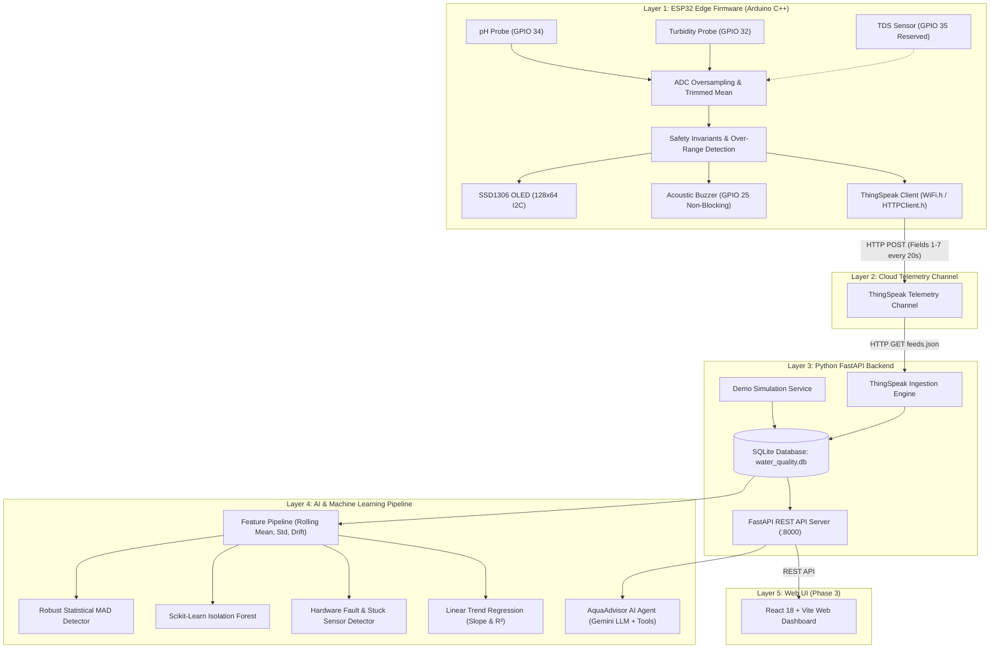

# Smart Apartment Water Quality Monitor

[](#firmware-compilation)
[](#python-fastapi-backend)
[](#running-the-test-suite)
[](#system-architecture)

An intelligent, full-stack IoT and AI-enabled water quality monitoring system designed for modern residential buildings and apartments. The system continuously measures water parameters, provides immediate local audio-visual alerts, uploads telemetry to ThingSpeak cloud infrastructure, detects statistical and machine learning anomalies, and delivers conversational diagnostics through an AI Water Quality Advisor.

---

## 1. Project Overview & Multi-Phase Roadmap

The project is structured into three progressive engineering phases:

- **Phase 1 (Completed)**:
  - High-reliability ESP32 embedded firmware (Arduino C++).
  - Multi-sensor acquisition: E201-C pH electrode and optical turbidity probe.
  - Reserved GPIO 35 for future TDS expansion (strictly reports NULL/unavailable).
  - Electrical safety engineering & voltage divider verification ($15\text{ k}\Omega / 10\text{ k}\Omega$).
  - I2C SSD1306 OLED multi-page dashboard & acoustic non-blocking buzzer alert engine.
  - Initial directory tree, unit tests, and hardware documentation.
- **Phase 2 (Completed)**:
  - **ThingSpeak Cloud Integration**: Actual 7-field REST telemetry integration in ESP32 firmware with non-blocking transmission, retry with backoff, and upload tracking.
  - **Python FastAPI Backend**: Async telemetry ingestion, SQLite persistence, and REST endpoints (`/api/health`, `/api/readings/latest`, `/api/alerts`, `/api/system/status`).
  - **Demo & Simulation Engine**: Realistic offline telemetry generation supporting `normal`, `warning`, `critical`, `sensor_fault`, and `stale` scenarios with strict TDS null preservation.
  - **Machine Learning Layer**: Robust statistical anomaly detection (Rolling Median & MAD), Scikit-learn multivariate Isolation Forest, sensor hardware fault detector, and linear trend regression.
  - **AI Chatbot Service**: AquaAdvisor conversational agent with provider-agnostic LLM adapter (Google Gemini / OpenAI) and offline domain rule fallback.
  - **Automated Test Suite**: 47 comprehensive pytest unit and integration tests.
- **Phase 3 (Next Step)**:
  - React 18 & Vite interactive web dashboard with real-time charts and alert center.

---

## 2. Hardware Specifications

| Component | Specification | Connection Details | Role |
| :--- | :--- | :--- | :--- |
| **Microcontroller** | ESP32-D0WD-V3 (ESP32 Dev Module) | USB-C on macOS | Core edge controller, local alerting & telemetry |
| **pH Sensor** | E201-C BNC Electrode + Green Board | GPIO 34 via 15kΩ/10kΩ divider | Analog acquisition & 2-point buffer calibration |
| **Turbidity Sensor** | Optical Probe + Red Board | GPIO 32 via 15kΩ/10kΩ divider | Analog acquisition & clean water baseline |
| **TDS Sensor** | *Hardware Not Arrived* | GPIO 35 (Reserved) | Strict N/A handling; disabled until physically present |
| **OLED Display** | SSD1306 128×64 Monochrome | I2C (SDA=21, SCL=22, 0x3C) | Real-time dashboard & electrical diagnostics |
| **Audio Buzzer** | Active/Passive Buzzer Module | GPIO 25 (Signal) | Non-blocking acoustic alert patterns |
| **Host Machine** | Apple Silicon M5 MacBook Air | macOS, 16 GB RAM | Development, compilation, backend, and ML host |

---

## 3. System Architecture



---

## 4. Telemetry Data Contract (ThingSpeak Fields)

The ESP32 firmware posts telemetry every 20 seconds formatted as follows:

| Field | Parameter | Type | Value Format | Behavior when Uncalibrated / Absent |
| :---: | :--- | :---: | :--- | :--- |
| **Field 1** | pH | Float | `0.00` to `14.00` | Omitted from payload; never fabricated |
| **Field 2** | Turbidity | Float | `0.0` to `3000.0` NTU | Omitted from payload; never fabricated |
| **Field 3** | TDS | Float | ppm | **Omitted / Blank (Strict: NEVER 0.0)** |
| **Field 4** | Alert Severity | Integer | `0`=Normal, `1`=Warn, `2`=Crit, `3`=Fault | Transmitted as integer code |
| **Field 5** | pH Board Voltage | Float | Volts ($V_{ADC} \times 2.50$) | Raw diagnostic board voltage |
| **Field 6** | Turbidity Board Voltage | Float | Volts ($V_{ADC} \times 2.50$) | Raw diagnostic board voltage |
| **Field 7** | System Health Code | 16-bit Int | Encoded bitmask | Bit 0: Wi-Fi, 2: pH, 3: Turb, 4: Over-range, 5: TDS absent |

---

## 5. Quickstart Guide

### A. Verifying & Compiling Firmware (macOS)
```bash
./scripts/compile_firmware.sh
```
*Output: Sketch uses 1,077,616 bytes (82%) of flash, 50,800 bytes (15%) of RAM. 0 errors.*

### B. Setting Up Python Backend (macOS Apple Silicon)
```bash
# 1. Create and activate virtual environment
python3 -m venv backend/venv
source backend/venv/bin/activate

# 2. Install dependencies
pip install -r backend/requirements.txt

# 3. Configure environment
cp backend/.env.example backend/.env
# By default, DATA_MODE=demo allows immediate testing without physical ESP32 or keys!

# 4. Start the FastAPI server
uvicorn app.main:app --app-dir backend --reload --port 8000
```

### C. Accessing Interactive Swagger Documentation
Open your browser to:
- **Swagger UI**: [http://localhost:8000/docs](http://localhost:8000/docs)
- **ReDoc**: [http://localhost:8000/redoc](http://localhost:8000/redoc)

### D. Running the Test Suite
```bash
./backend/venv/bin/pytest backend/tests -v
```
*Output: 47 passed in 1.18 seconds.*

---

## 6. Primary REST API Endpoints

| Method | Endpoint | Description |
| :--- | :--- | :--- |
| `GET` | `/api/health` | Backend health, cloud connectivity, last sync timestamp |
| `GET` | `/api/system/status` | Decoded hardware bitmask, sensor availability, Wi-Fi |
| `GET` | `/api/readings/latest` | Most recent telemetry reading with voltages & data source |
| `GET` | `/api/readings/history?limit=50` | Historical time-series telemetry |
| `GET` | `/api/readings/statistics?hours=24` | 24-hour summary metrics (mean, min, max) |
| `GET` | `/api/alerts` | Active warnings, critical alerts, and incident summary |
| `GET` | `/api/ml/anomalies` | Multi-tier anomaly detection (MAD + Isolation Forest + Faults) |
| `GET` | `/api/ml/trends` | Linear trend regression slopes and R² baseline drift |
| `GET` | `/api/ml/summary` | Categorized AI insights (FACT, ANOMALY, PREDICTION, WARNING) |
| `POST` | `/api/chat` | AI Water Quality Advisor conversational query |
| `POST` | `/api/demo/inject/{scenario}` | Inject `warning`, `critical`, or `sensor_fault` test events |
| `POST` | `/api/thingspeak/sync` | Trigger cloud telemetry synchronization |

---

## 7. Machine Learning & AI Chatbot Capabilities

1. **Robust Statistical Anomaly Detection**: Uses non-parametric Median Absolute Deviation (MAD) and moving Z-Scores to catch sharp turbidity spikes and pH shifts without requiring large training sets.
2. **Multivariate Isolation Forest**: Scikit-learn unsupervised tree ensemble identifying correlated parameter deviations across pH, turbidity, and sensor board voltages.
3. **Hardware Fault Detection**: Distinguishes hardware op-amp freeze (`HARDWARE_STUCK_VALUE`), disconnected probes (`PROBE_DISCONNECTED`), and hazardous voltage (`ELECTRICAL_OVER_RANGE`) from real water quality contamination.
4. **AquaAdvisor AI Chatbot**: Provider-agnostic agent supporting Google Gemini, OpenAI, or local offline domain rules. Adheres to strict drinking water safety rules (never claiming water is safe to drink based solely on basic sensors).

---

## 8. Detailed Documentation Directory

For complete guides, refer to the documentation in `docs/`:

- [docs/THINGSPEAK_SETUP.md](file:///Users/berunadh/Desktop/projects/O3_S1_TBP/Smart-Water-Quality-Monitor/docs/THINGSPEAK_SETUP.md) — Step-by-step account, channel, and API key setup.
- [docs/PYTHON_BACKEND_SETUP.md](file:///Users/berunadh/Desktop/projects/O3_S1_TBP/Smart-Water-Quality-Monitor/docs/PYTHON_BACKEND_SETUP.md) — Virtual environment, FastAPI configuration, and endpoint usage.
- [docs/ML_AND_AI_CHATBOT.md](file:///Users/berunadh/Desktop/projects/O3_S1_TBP/Smart-Water-Quality-Monitor/docs/ML_AND_AI_CHATBOT.md) — Anomaly detection math, fault detection, and chatbot safety guardrails.
- [docs/DATA_SCHEMA.md](file:///Users/berunadh/Desktop/projects/O3_S1_TBP/Smart-Water-Quality-Monitor/docs/DATA_SCHEMA.md) — Full data contracts, Pydantic schemas, and SQLite database tables.
- [docs/ELECTRICAL_SAFETY.md](file:///Users/berunadh/Desktop/projects/O3_S1_TBP/Smart-Water-Quality-Monitor/docs/ELECTRICAL_SAFETY.md) — Voltage divider calculations and multimeter commissioning protocol.
- [docs/CALIBRATION_GUIDE.md](file:///Users/berunadh/Desktop/projects/O3_S1_TBP/Smart-Water-Quality-Monitor/docs/CALIBRATION_GUIDE.md) — 2-point buffer and turbidity calibration protocol.
