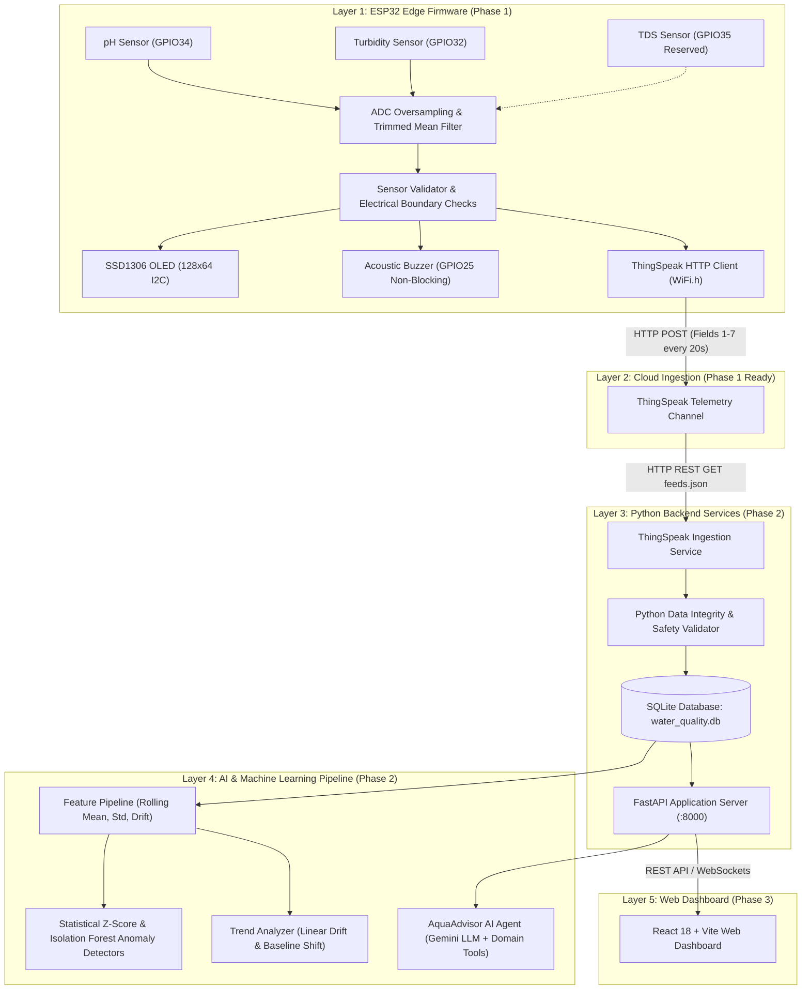

# System Architecture & Multi-Phase Roadmap

---

## 1. Architectural Layers & Responsibilities

### Layer 1: ESP32 Edge Firmware (Embedded C++)
- **Core Role**: Physical sensor acquisition, noise filtering, electrical over-range safety checks, and immediate local acoustic/visual warning.
- **Fail-Safe Design**: Operates 100% autonomously without requiring an active internet connection or server. If Wi-Fi disconnects or ThingSpeak drops, sensor sampling, OLED status display, and buzzer alerts continue uninterrupted.

### Layer 2: Cloud Telemetry Channel (ThingSpeak)
- Serves as an intermediary cloud buffer between the edge microcontroller and the Python application backend.
- Stores continuous time-series telemetry structured according to our 7-field data contract:
  - `field1`: Calibrated pH
  - `field2`: Calibrated Turbidity (NTU)
  - `field3`: Calibrated TDS (ppm, reserved)
  - `field4`: Alert Severity (0=Normal, 1=Warning, 2=Critical, 3=Sensor Fault)
  - `field5`: pH Board Output Voltage ($V_{board}$)
  - `field6`: Turbidity Board Output Voltage ($V_{board}$)
  - `field7`: System Health Bitmask (16-bit integer)

### Layer 3: Python Backend Services (FastAPI + SQLite)
- **Core Role**: Ingests cloud telemetry, enforces schema contracts, computes aggregate statistics, and provides clean REST endpoints for dashboards and analytical models.
- **Data Quality Invariants**: Validates that uninstalled sensors (TDS) are never stored as zero, checks for ADC saturation, and flags electrical hazards.

### Layer 4: AI & Machine Learning Pipeline
- **Anomaly Detection**: Moving statistical Z-Score detector flags abrupt pipe flushing, particulate spikes, or chemical anomalies. Unsupervised Isolation Forest is prepared for multivariate patterns.
- **Trend Analysis**: Computes linear drift rates (e.g. gradual filter degradation or seasonal temperature shifts).
- **AI Chatbot**: AquaAdvisor provides conversational explanations of EPA/WHO standards and apartment plumbing diagnostics.

### Layer 5: Web UI (React & Vite Dashboard - Phase 3)
- Real-time telemetry monitoring, historical chart inspection, alert resolution, and interactive AI chatbot interface.

---

## 2. Telemetry Contract Matrix

| Field | Parameter | Engineering Units | Permitted Values | Handling when Uncalibrated / Absent |
| :---: | :--- | :---: | :---: | :--- |
| **Field 1** | pH | pH scale (0–14) | 0.00 to 14.00 | Omitted (empty string); never fabricated |
| **Field 2** | Turbidity | NTU | $\ge 0.0$ NTU | Omitted (empty string); never fabricated |
| **Field 3** | TDS | ppm | $\ge 0.0$ ppm | **Omitted / Blank (STRICT: NEVER 0.0)** |
| **Field 4** | Alert Severity | Integer Enum | 0, 1, 2, 3 | 0=Normal, 1=Warning, 2=Critical, 3=Fault |
| **Field 5** | pH Board Voltage | Volts (V) | 0.000 to 5.000 V | Reconstructed board voltage ($V_{ADC} \times 2.50$) |
| **Field 6** | Turbidity Board Voltage | Volts (V) | 0.000 to 5.000 V | Reconstructed board voltage ($V_{ADC} \times 2.50$) |
| **Field 7** | System Health Code | 16-bit Bitmask | Bit 0 through 7 | Encodes Wi-Fi, Cloud, Fault, and Safety states |
