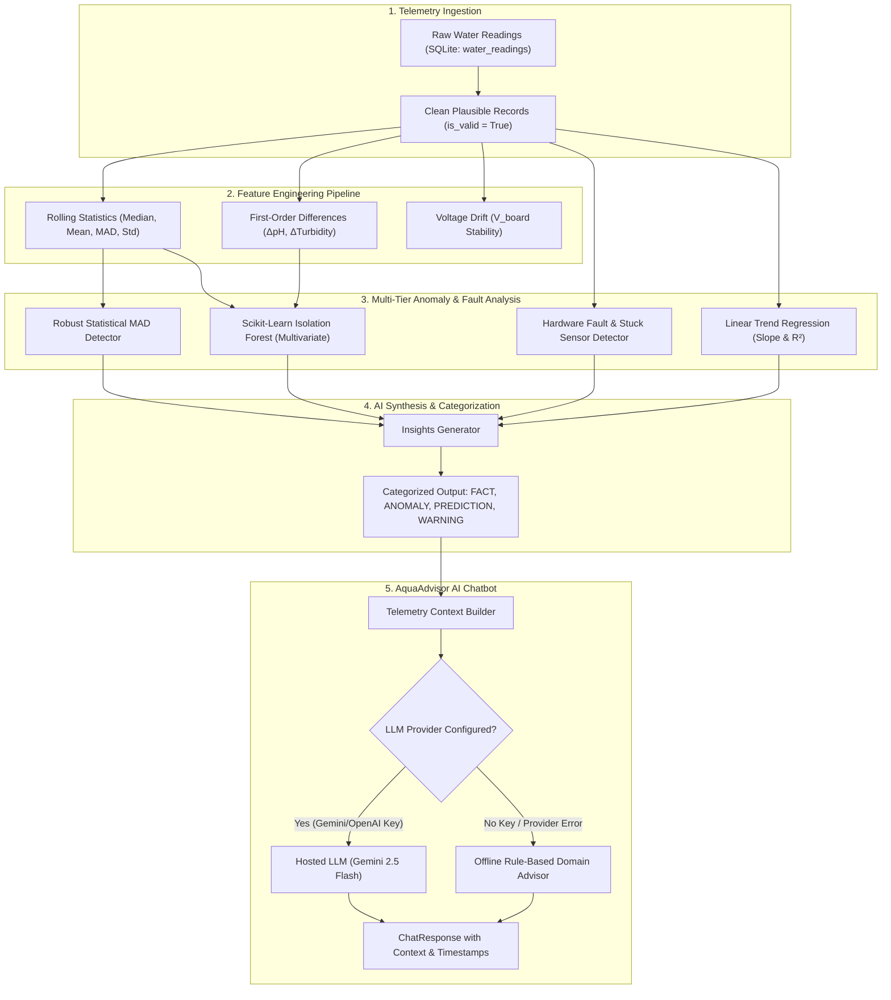

# Machine Learning & AI Chatbot Architecture

This document details the mathematical algorithms, data processing pipelines, model training workflows, and conversational AI architecture implemented in **Phase 2**.

---

## 1. Machine Learning Pipeline Overview



---

## 2. Anomaly Detection Algorithms

### A. Robust Statistical Detector (Median Absolute Deviation & Z-Score)
Traditional moving average and standard deviation are heavily skewed by extreme outliers (contamination spikes). This detector employs **non-parametric robust statistics**:

$$\text{Median} = \tilde{x} = \text{median}(X)$$
$$\text{MAD} = \text{median}(|X - \tilde{x}|)$$
$$\hat{\sigma}_{\text{robust}} = 1.4826 \times \text{MAD}$$
$$Z_{\text{robust}} = \frac{|x_i - \tilde{x}|}{\hat{\sigma}_{\text{robust}}}$$

- **Threshold**: Any reading where $Z_{\text{robust}} > 3.0$ is flagged as a `STATISTICAL_ANOMALY`.
- **Advantage**: Detects sharp turbidity spikes or sudden pH shifts without requiring pre-trained weights or weeks of historical data.

### B. Multivariate Isolation Forest (Scikit-Learn)
While univariate Z-scores detect single-parameter spikes, water quality hazards often involve **correlated deviations across multiple features**:
- **Features Used**: `[ph, turbidity, ph_voltage, turbidity_voltage]`
- **Algorithm**: `sklearn.ensemble.IsolationForest`
  - $100$ isolation trees (`n_estimators = 100`).
  - Contamination rate: $0.05$ ($5\%$).
  - Evaluates how few random partition cuts are required to isolate a telemetry point. Outliers isolate at shallow depths.
- **Persistence**: Saved as lightweight binary `backend/app/ml/models/isolation_forest.joblib` (~180 KB) with version metadata in `isolation_forest_meta.json`.

---

## 3. Sensor Fault Detection vs. Water Quality Contamination

A critical engineering requirement is **distinguishing physical hardware failures from real chemical/particulate water anomalies**:

| Failure Mode | Electrical/Physical Characteristic | Classification | Detector Action |
| :--- | :--- | :--- | :--- |
| **Stuck Op-Amp / Stalled ADC** | $K \ge 6$ consecutive readings with **$0.000$ variance** while voltage $>0.05\text{V}$ | `RULE_BASED_WARNING` (Hardware) | Flags `HARDWARE_STUCK_VALUE`; alerts user to check op-amp chip |
| **Disconnected Probe** | Sensor board voltage drops below $0.08\text{V}$ | `RULE_BASED_WARNING` (Hardware) | Flags `PROBE_DISCONNECTED`; probe unplugged or cable severed |
| **Electrical Over-Range** | $V_{board} \times 0.40 \ge 3.05\text{V}$ ($V_{board} > 7.625\text{V}$) | `RULE_BASED_WARNING` (Hardware) | Flags `ELECTRICAL_OVER_RANGE`; hazardous voltage at ESP32 ADC pin |
| **Implausible Step Jump** | Instantaneous jump $>2.5\text{ pH}$ or $>50\text{ NTU}$ in $<20$ seconds | `RULE_BASED_WARNING` (Hardware) | Flags `IMPLAUSIBLE_STEP_JUMP`; physical mechanical shock |
| **True Turbidity Spike** | Voltage drops smoothly from $4.2\text{V}$ to $3.2\text{V}$, NTU jumps from $0.8$ to $12\text{ NTU}$ with natural noise | `STATISTICAL_ANOMALY` (Water) | Flags particulate contamination event |

---

## 4. Model Training & Retraining Workflow

To maintain absolute scientific integrity, the project handles training as follows:

1. **Initial Baseline Calibration**:
   - The system synthesizes a controlled, realistic municipal water baseline ($600$ samples) with natural Gaussian jitter and known injected disturbances.
   - **Crucial Rule**: The metadata file `isolation_forest_meta.json` explicitly marks `"trained_on_synthetic_data": true` and notes that real-world accuracy claims are withheld until validated on live sensors.
2. **Retraining on Real Historical Telemetry**:
   - Once your ESP32 is deployed and has accumulated $\ge 50$ valid telemetry records in SQLite, trigger retraining via:
     ```bash
     curl -X POST http://localhost:8000/api/ml/train
     ```
   - The model automatically retrains on accumulated real-world readings, updates hyperparameters, and saves new model weights.

---

## 5. Categorized AI Insights Generator

The endpoint `GET /api/ml/summary` delivers human-readable summaries where every statement is explicitly tagged with its epistemological category:

- `MEASURED_FACT`: Indisputable physical measurement (e.g. *"Latest telemetry at 22:15:00 UTC: pH = 7.35, Turbidity = 0.8 NTU"*).
- `STATISTICAL_ANOMALY`: Non-parametric statistical deviation (e.g. *"Turbidity spiked 4.2σ above moving median"*).
- `ML_PREDICTION`: Unsupervised model inference (e.g. *"Multivariate Isolation Forest identified outlier state with score 0.142"*).
- `RULE_BASED_WARNING`: Invariant or electrical safety breach (e.g. *"Telemetry stream is stale. Last transmission was 12 minutes ago"*).

---

## 6. AI Water Quality Advisor Chatbot (`POST /api/chat`)

### Architecture
- **Provider-Agnostic Adapter**: Supports **Google Gemini** (`gemini-2.5-flash`), **OpenAI** (`gpt-4o-mini`), or **Offline Fallback**.
- **Context Injection**: Every query retrieves:
  1. Live telemetry reading (pH, turbidity, TDS, voltages, health status).
  2. 24-hour summary metrics (averages, min, max, count).
  3. Active alerts and recent incident logs.
  4. Dominant trend and ML anomaly scores.
  5. EPA/WHO drinking water guidelines.

### Safety Guardrails (Strict Response Boundaries)
1. **Never Certify Potability**: The chatbot will **never** claim water is safe to drink based solely on pH and turbidity. It explicitly reminds the user that microbial pathogens (bacteria, viruses) require laboratory culturing.
2. **Explain Missing TDS**: Clarifies that TDS is reserved on GPIO 35 and uninstalled, and does not invent false ppm readings.
3. **No Unsubstantiated Health Claims**: Does not diagnose medical ailments.
4. **Resilient Fallback**: If no API key is provided, or if the external LLM provider drops the connection, the agent degrades seamlessly to the offline domain rule engine, ensuring 100% availability.
