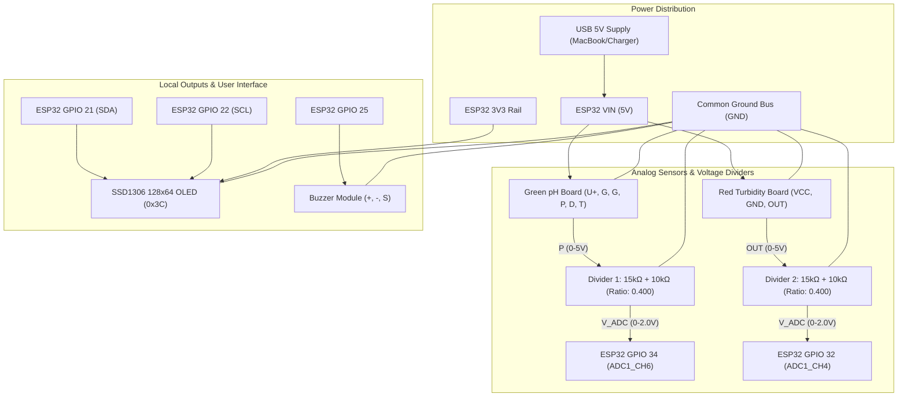

# Wiring Diagrams & Schematic Guide

This document details the exact physical wiring connections for the **Smart Apartment Water Quality Monitor**.

---

## 1. System Block Diagram (Mermaid)



---

## 2. Voltage Divider Schematic (Detailed)

Both the **pH board** and the **Turbidity board** are supplied with 5V and produce 0V to ~4.5V/5.0V output signals. The ESP32 ADC pin absolute maximum rating is 3.6V (recommended safe linear range $\le 3.0\text{V}$).

To step down the signal safely, an identical voltage divider is placed on each analog line:

```
Sensor Output (P or OUT)
         │
         ▼
     [ 15 kΩ ]  (R1 - Top Resistor)
         │
         ├──────────────────────────────► To ESP32 ADC (GPIO 34 or GPIO 32)
         │
     [ 10 kΩ ]  (R2 - Bottom Resistor)
         │
         ▼
    Common Ground (GND)
```

### Divider Equations:
$$V_{ADC} = V_{sensor} \times \left( \frac{R_2}{R_1 + R_2} \right) = V_{sensor} \times \left( \frac{10\text{ k}\Omega}{15\text{ k}\Omega + 10\text{ k}\Omega} \right) = V_{sensor} \times 0.400$$

$$V_{sensor\_reconstructed} = \frac{V_{ADC}}{0.400} = V_{ADC} \times 2.500$$

- Maximum 5.0V sensor output becomes: $5.00\text{ V} \times 0.400 = 2.00\text{ V}$ at the ESP32 pin (100% within the safe linear range of 11dB attenuation).

---

## 3. Peripheral-by-Peripheral Wiring

### A. pH Sensor (E201-C Electrode + Green Signal Conditioning Board)
The green signal conditioning board has a 6-pin header labeled `T, D, P, G, G, U+`:
- **U+** $\rightarrow$ Connect to ESP32 **VIN** (5V power rail)
- **G** $\rightarrow$ Connect to **GND** (Common Ground)
- **G** $\rightarrow$ Connect to **GND** (Common Ground)
- **P** $\rightarrow$ Analog Output $\rightarrow$ Connect to one side of **15 kΩ resistor**
- **D** $\rightarrow$ Digital output trigger potentiometer (Leave disconnected / NC)
- **T** $\rightarrow$ Temperature probe solder pad (Leave disconnected / NC)
- **15 kΩ Resistor other side** $\rightarrow$ Connect to **ESP32 GPIO 34** AND one side of **10 kΩ resistor**
- **10 kΩ Resistor other side** $\rightarrow$ Connect to **GND**

### B. Turbidity Sensor (Optical Probe + Red Signal Conditioning Board)
The red signal conditioning board has a 3-pin header labeled `VCC, OUT, GND` and a probe cable connector:
- **VCC** $\rightarrow$ Connect to ESP32 **VIN** (5V power rail)
- **GND** $\rightarrow$ Connect to **GND** (Common Ground)
- **OUT** $\rightarrow$ Connect to one side of **15 kΩ resistor**
- **15 kΩ Resistor other side** $\rightarrow$ Connect to **ESP32 GPIO 32** AND one side of **10 kΩ resistor**
- **10 kΩ Resistor other side** $\rightarrow$ Connect to **GND**

### C. OLED Display (SSD1306 128×64 0.96" I2C)
- **VCC** $\rightarrow$ Connect to ESP32 **3V3**
- **GND** $\rightarrow$ Connect to **GND**
- **SCL** $\rightarrow$ Connect to ESP32 **GPIO 22**
- **SDA** $\rightarrow$ Connect to ESP32 **GPIO 21**

### D. Buzzer Module
- **+ (or VCC)** $\rightarrow$ Connect to ESP32 **3V3** (or 5V if 5V-rated active buzzer)
- **- (or GND)** $\rightarrow$ Connect to **GND**
- **S (Signal)** $\rightarrow$ Connect to ESP32 **GPIO 25**

### E. TDS Sensor (Future Reservation)
- **VCC** $\rightarrow$ Reserved for 3.3V or 5V (upon datasheet verification)
- **GND** $\rightarrow$ Reserved for GND
- **OUT** $\rightarrow$ Reserved for ESP32 **GPIO 35**
